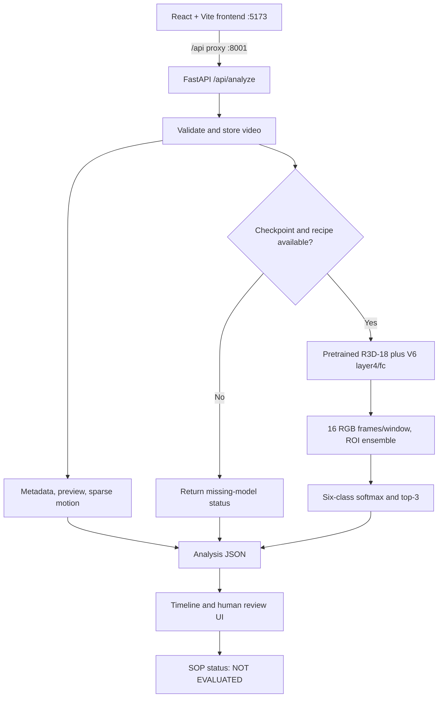
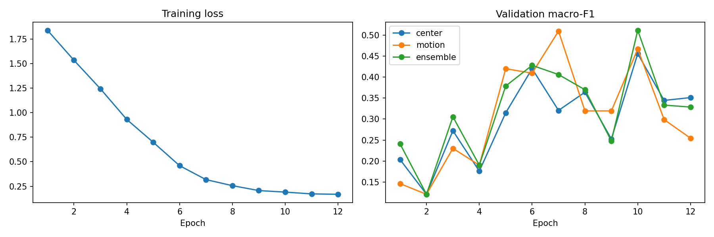
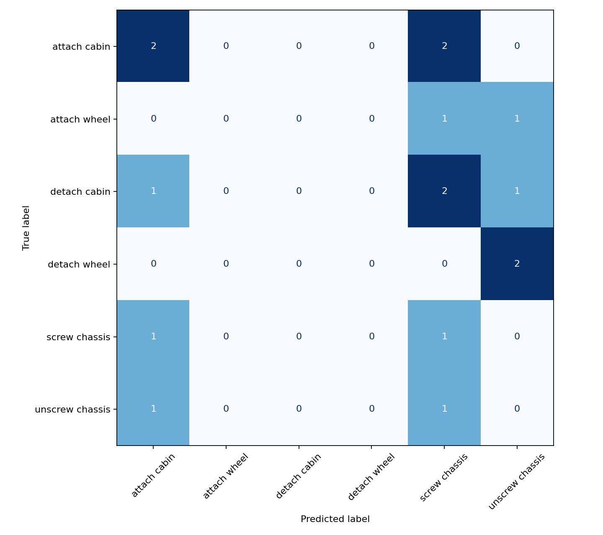
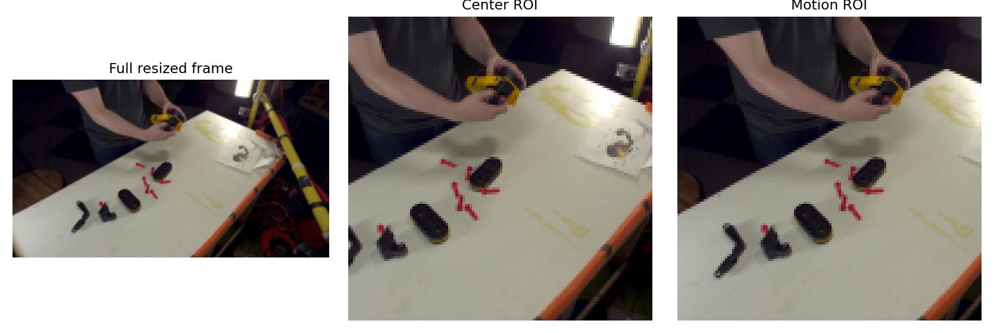

# VisualSOP Checker

**Day 30 of 100 Days of Projects · Manufacturing / Computer Vision · Research prototype**  
**Language:** [English](#english-documentation) · [Bahasa Indonesia](#dokumentasi-bahasa-indonesia)  
**Repository:** https://github.com/MENSTRUE/VisualSOP-Checker  
**Status:** Working local V6 inference prototype; **not** a validated SOP compliance system.  
**Last evidence review:** 2026-11-04. Read [claim boundaries](#en-claim-boundaries) before citing results.

> **Research integrity notice:** The R3D-18 model recognizes six *toy assembly activity* categories. Its validation accuracy is **52.94% (9/17)** and its **historically exposed, non-blind exploratory test accuracy is 18.75% (3/16)**. A working demonstration proves inference execution, **not prediction correctness, SOP adherence, or production readiness**.


*Actual screenshot tracked in the repository, not an AI-generated product mockup. UI content and model availability vary by local runtime.*

| Research baseline | Value | Evidence |
|---|---:|---|
| Video classification task | 6 coarse actions | [`models/MODEL_CARD.json`](models/MODEL_CARD.json) |
| Independent training intervals | 62 (124 correlated views) | [`reports/v6/reports/results.json`](reports/v6/reports/results.json) |
| Validation accuracy / macro-F1 | **52.94% / 51.11%** | [`results.json`](reports/v6/reports/results.json) |
| Reused exploratory test accuracy / macro-F1 | **18.75% / 11.11%** | [`results.json`](reports/v6/reports/results.json) |
| Blind held-out test | **Not available** | [`models/MODEL_CARD.json`](models/MODEL_CARD.json) |
| Real R3D-18 inference integration | Implemented and locally smoke-tested | [`backend/app/v6_inference.py`](backend/app/v6_inference.py) |
| SOP violation evaluation | **Not implemented** | `sop_status: not_evaluated` |

---

<a id="english-documentation"></a>
# English documentation

## EN — Table of contents

1. [Project overview](#en-overview)
2. [Problem, users, objectives and scope](#en-problem)
3. [Before → Now → Next](#en-before-now-next)
4. [Evidence-backed feature register](#en-feature-register)
5. [Architecture and actual visual assets](#en-architecture)
6. [Dataset sources and provenance](#en-dataset)
7. [Dataset audit, labels and split](#en-data-audit)
8. [Leakage and validity risks](#en-leakage)
9. [Model architecture and preprocessing](#en-model)
10. [Experiments, champion selection and evaluation](#en-evaluation)
11. [Interpretation and error analysis](#en-interpretation)
12. [Repository structure](#en-structure)
13. [Installation and running the app](#en-setup)
14. [API and output contract](#en-api)
15. [Testing, reproducibility and acceptance criteria](#en-testing)
16. [Deployment, operations, security and privacy](#en-deployment)
17. [Known limitations and claim boundaries](#en-claim-boundaries)
18. [Roadmap](#en-roadmap)
19. [Troubleshooting](#en-troubleshooting)
20. [FAQ](#en-faq)
21. [License, provenance, references and citation](#en-license)
22. [Maintainer source-of-truth protocol](#en-maintenance)

<a id="en-overview"></a>
## 1. Project overview

**VisualSOP Checker** investigates whether short video clips from toy assembly/disassembly can be recognized as coarse activities, with transparent timestamps and reviewable model outputs. It is one project in the **100 Days of Projects** research-to-application portfolio. The desired longer-term problem—visual assistance for reviewing assembly standard operating procedures—requires reliable event boundaries, defined expected steps, object/part states, procedural ordering and *actual SOP violation annotations*. Those capabilities are not established by classifying an isolated action.

Today the repository contains an **executed experimental notebook**, data/metric artifacts, a **FastAPI backend**, a **React/TypeScript/Vite frontend**, and a **real V6 model loading path**. A local test uploaded an Assembly101-derived **20-second, 1280×720, 60-fps** video and returned **10 overlapping time windows**, `model_status=experimental_v6`, `ai_error=null`, and `sop_status=not_evaluated`. Nine windows were classified `detach cabin`, one `detach wheel`; **these are unverified predictions rather than ground-truth findings**. The screenshot above is tracked in `assets/screenshots/`.

**One-sentence portfolio claim:** *A research-only six-class Assembly101 activity-recognition prototype, with an R3D-18 V6 model integrated into a working local video-analysis API and UI; generalization is not yet reliable, and SOP violation detection is not implemented.*

<a id="en-problem"></a>
## 2. Problem, users, objectives and scope

### Problem statement

Manual review of assembly videos can be slow and inconsistent. An experimental model can offer **hypotheses** about actions performed in a time range, helping researchers inspect failure modes. However, an activity label does not establish that an authorized procedure was followed, or that a missing step occurred.

### Current research question

Can transfer learning from Kinetics-400 video recognition provide usable evidence for distinguishing six annotated coarse Assembly101 actions on **source-group-disjoint** splits, and can the experimental model run inside a real application without replacing its outputs with fabricated predictions?

### Objectives and deliverables

- Audit source data, annotation timebase, usable video matches, class counts, split integrity and leakage risks.
- Build and evaluate a six-class model while separating validation-based selection from an historically exposed exploratory test.
- Export **actual** model checkpoint metadata, an inference recipe, audit files, logs and plots.
- Expose a local API for video upload, metadata, motion indicator, preview and actual model predictions.
- Display timestamped predictions in a web UI, with visible model error/uncertainty and an explicit *not evaluated* SOP status.
- Preserve enough provenance to **reproduce or explain failure to reproduce** the experiment.

**Intended use:** computer vision research, demonstration, debugging and human review of toy-assembly action hypotheses. **Not intended:** safety-critical monitoring, industrial SOP validation, worker assessment, disciplinary decisions, automatic approvals or independent compliance certification.

### In-scope vs out-of-scope

| In scope (current) | Out of scope (not implemented/validated) |
|---|---|
| Six predefined toy assembly classes | Open-vocabulary recognition, unseen actions |
| Fixed-length clip inference | Ground-truth temporal segmentation |
| Local video upload and API | Public multi-tenant service / authentication |
| Motion differences and a preview | Motion as an SOP-violation signal |
| Uncalibrated softmax top-3 | Calibrated probability and safety threshold |
| Heuristic overlapping video windows | Automatic SOP sequence/deviation decisions |
| Research reports and transparent limitations | Production certification, independent blind benchmark |

<a id="en-before-now-next"></a>
## 3. Before → Now → Next

| Period | What actually happened | Evidence / remaining work |
|---|---|---|
| **BEFORE — data and experiment** | Assembly101 videos and coarse annotations paired; timestamp mismatch considered; R3D-18 experiments undertaken; V6 chosen by validation evidence. | `notebooks/visualsop-checker.ipynb`, `reports/v6/audit/`, V6 metadata, plots, predictions. |
| **BEFORE — limitations established** | Only 13 paired sessions; 62 independent train intervals; 17 val; 16 previously exposed exploratory test; 80% target not reached. | [`MODEL_CARD.json`](models/MODEL_CARD.json), [`results.json`](reports/v6/reports/results.json). |
| **NOW — backend** | Local FastAPI can accept a video, generate metadata/motion/preview, load the V6 model and classify overlapping windows. | [`main.py`](backend/app/main.py), [`v6_inference.py`](backend/app/v6_inference.py); local smoke-test transcript. |
| **NOW — frontend** | React/Vite is connected via `/api` proxy to port 8001. Local UI presents the video analysis experience. | [`frontend/src/main.tsx`](frontend/src/main.tsx), [`vite.config.ts`](frontend/vite.config.ts), actual screenshot. |
| **NEXT — scientific** | Reconcile demo predictions with source annotations; add more legally usable independent sessions, fresh blind test, calibrated confidence and a robust temporal protocol. | New experimental artifacts and failure analysis **not yet completed**. |
| **NEXT — SOP product** | Define SOP templates, required-step order, omission/deviation ground truth, event localization, review queue and override/audit trail. | Requires a new task definition/dataset, independent validation and human oversight. |
| **LATER — deployment** | Harden uploads, privacy, authentication, observability, model loading, resource limits and monitoring. | No production deployment claim. |

<a id="en-feature-register"></a>
## 4. Feature and evidence register

| Feature | Status | Important caveat |
|---|---|---|
| `GET /api/health` | Implemented | `model_inference_enabled=true` means files were found, **not** that the model executed successfully. |
| `POST /api/analyze` | Implemented | Video metadata, motion samples, optional real model inference. |
| Retrieve saved analysis | Implemented | Local disk persistence; not a managed database. |
| Preview image | Implemented | Server-selected frame, not detection visualization. |
| V6 model reconstruction | Implemented | Requires pretrained Kinetics-400 backbone **and** local fine-tuned layer4/fc. |
| 3-second window, 2-second stride classification | Implemented | Heuristic windows; overlap means predictions are correlated. |
| Top-3 classes and `uncertain` flag | Implemented | Threshold 0.65 is heuristic; scores not calibrated. |
| Six-class accuracy report | Completed experimental result | Validation 52.94%; reused exploratory test 18.75%. |
| Automated SOP step checks | Not implemented | `sop_status: not_evaluated`. |
| 80% accuracy milestone | Not achieved | No alternative success metric should conceal this. |
| Fresh blind held-out evaluation | Not completed | Earlier exploratory test must not be relabeled blind. |
| Formal frontend/backend regression suite | Not verified in current evidence | Roadmap / manual checks below are **procedures**, not claimed passing tests. |
| Production deployment and safeguards | Not completed | Local development demonstration only. |

<a id="en-architecture"></a>
## 5. Architecture, data flow and real visual evidence

### Actual architecture (textual diagram, derived from code)



**Training protocol is not the demo protocol.** Training/validation/test classify annotated action intervals. The app classifies fixed 3-second windows with 2-second stride; no learned action onset/offset detection exists. Temporal-localization performance has not been measured for this API.

### Real experimental graphics (tracked repository files)



*Learning curves exported by the V6 research workflow. Consult [`training_history.csv`](reports/v6/reports/training_history.csv) for the underlying epoch records; do not infer a new metric from the image alone.*



*Confusion matrix from the historically exposed exploratory test, **not an untouched final holdout**. Numeric source: [`test_confusion_matrix.csv`](reports/v6/reports/test_confusion_matrix.csv), per-class analysis: [`test_per_class.csv`](reports/v6/reports/test_per_class.csv).*



*Center versus motion-guided ROI crop examples from the experiment. The motion ROI is a pixel-difference heuristic, not segmentation or object detection.*


*Actual tracked screenshot; appearance and displayed state depend on runtime. This is **not** evidence of SOP compliance or prediction accuracy.*

### Asset register — use images that exist, never invented URLs

| Location | Current role | Usage |
|---|---|---|
| [`assets/plots/learning_curves.png`](assets/plots/learning_curves.png) | Actual experiment visual | Embedded above. |
| [`assets/plots/test_confusion_matrix.png`](assets/plots/test_confusion_matrix.png) | Actual exploratory-test confusion visual | Embedded above. |
| [`reports/v6/examples/center_vs_motion_roi.jpg`](reports/v6/examples/center_vs_motion_roi.jpg) | ROI comparison | Embedded above. |
| [`assets/screenshots/Screenshot 2026-11-04 193324.png`](assets/screenshots/Screenshot%202026-11-04%20193324.png) | Local application screenshot | Embedded above. |
| [`reports/v6/plots/`](reports/v6/plots/) | Alternate/reference figure exports | Link to existing files; avoid duplicative image embeds. |
| `assets/examples/`, `assets/diagrams/` | Placeholder `.gitkeep` only at review time | **No fabricated example frames or diagram screenshots**; Mermaid diagram is source text. |

<a id="en-dataset"></a>
## 6. Dataset sources and provenance

**Primary research source:** [Assembly101 official site](https://assembly101.github.io/) and [Assembly101 dataset listing](https://huggingface.co/datasets/cvml-nus/assembly101). Domain: RGB recordings of toy assembly/disassembly. This is **not** a dataset of factory violations. The research used original coarse temporal annotations with restricted paired video subsets.

- Kaggle mounts recorded by the original experiment: `/kaggle/input/datasets/wafabila/visualsop-dataset` and `/kaggle/input/datasets/wafabila/visualsop-dataset-next`.
- Camera/file family recorded in provenance: `C10095_rgb.mp4`.
- Paired videos: **9 initial + 4 next = 13 sessions**.
- Coarse annotation files inventoried: **680**. This does **not** mean 680 matched/usable video sessions.
- **Annotation timebase:** 30 FPS for frame-index-to-second conversion; sampled RGB videos approximately 60 FPS. Do not treat annotation frame indices as raw recording frame indices.
- The model card notes **13/350 annotated sessions paired** in the audit context. File count, sessions, action intervals and augmented views are different entities.
- The upstream dataset has distinct access/license terms, recorded as **CC BY-NC 4.0 with gated conditions**; verify official current terms before use, derivative sharing or commercial deployment.
- Exact dataset version and date-of-access are **not evidenced in the provided manifests**. Do not invent either; complete provenance on the next controlled dataset acquisition.

Source-of-truth: [`reports/v6/metadata/dataset_provenance.json`](reports/v6/metadata/dataset_provenance.json), [`docs/dataset_provenance.md`](docs/dataset_provenance.md), and audit CSVs below. The MIT license in this repository covers its code, **not** Assembly101 footage or third-party pretrained model rights.

<a id="en-data-audit"></a>
## 7. Dataset audit, class definitions and split

### Audited subset and experimental units

| Count | V6 figure | Interpretation |
|---|---:|---|
| Paired RGB sessions | 13 | Research source coverage, **not** 13 independent factories. |
| Source annotation files | 680 | Audited input files; many lacked a matched selected video. |
| Independent train intervals | 62 | True action-interval count. |
| Train temporal views | 124 | Two correlated training views per interval; **not** 124 independent samples. |
| Validation intervals | 17 | Used for hyperparameter/ROI/model selection. |
| Reused exploratory test intervals | 16 | Previously inspected, **not blind**. |
| Total independent labelled intervals | 95 | 62 + 17 + 16 in this experiment only. |

### Fixed six-class label mapping

| Index | Exact model label | Coarse semantics |
|---:|---|---|
| 0 | `attach cabin` | Attach toy cabin. |
| 1 | `attach wheel` | Attach toy wheel. |
| 2 | `detach cabin` | Detach toy cabin. |
| 3 | `detach wheel` | Detach toy wheel. |
| 4 | `screw chassis` | Screw toy chassis. |
| 5 | `unscrew chassis` | Unscrew toy chassis. |

These indices **must match** the checkpoint's `class_names` and the recipe `head_classes`. Never reorder by frontend display preferences.

### Split protocol

| Split | Source toy groups | Independent intervals | Status |
|---|---|---:|---|
| Train | 9013, 9014, 9015, 9022 | 62 | Model optimization. |
| Validation | 9011, 9012 | 17 | Model/ROI selection. |
| Reused exploratory test | 9016, 9021 | 16 | Diagnostic only; not held-out blind. |

**Audit trail:** [`session_inventory.csv`](reports/v6/audit/session_inventory.csv), [`unmatched_annotation_sessions.csv`](reports/v6/audit/unmatched_annotation_sessions.csv), [`video_metadata.csv`](reports/v6/audit/video_metadata.csv), [`segments.csv`](reports/v6/audit/segments.csv), [`cached_clips.csv`](reports/v6/audit/cached_clips.csv).

### What was audited, and what remains to verify

Paired-session accounting, timestamp indexing, source-group separation and ROI/cache records exist. The repository does **not** establish an exhaustive independent duplicate/perceptual-leakage audit across every available Assembly101 view, nor full coverage of all 680 annotation files. Next versions should report: duplicate video hashes, interval overlap across cameras, per-class and per-group support, annotation consistency, withheld/failed decode counts, paired/unpaired source lists and checksums.

<a id="en-leakage"></a>
## 8. Data leakage and scientific validity risks

1. **Correlated training examples:** 124 sampled train views arise from 62 original intervals. Treating them as independent doubles the apparent sample size.
2. **Small validation set:** 17 intervals with repeated model/ROI experiments means selection can overfit validation; the chosen ensemble does not establish robustness.
3. **Historically exposed test:** 16 intervals were examined in earlier experiments and thus cannot support a fresh final unbiased claim.
4. **Group concentration:** 14 of 16 exploratory test intervals came from group 9021, creating high sensitivity to its distribution.
5. **Cross-view/session similarity:** toy assembly scenes can overlap; verify source/video identity, not merely clip filename.
6. **Timebase mismatch:** 30 FPS annotation indices vs approximately 60 FPS recordings can silently corrupt action timestamps if confused.
7. **Domain shift:** toy assembly video is not representative of real factory camera geometry, occlusions or equipment.

**Future independent evaluation rule:** collect new licensed paired sessions, declare unit of independence, freeze group-disjoint train/val/blind-test assignments *before* tuning, and run the blind test once after model selection. If an alleged blind test is inspected to guide changes, it becomes exploratory data and a new blind set must be reserved.

<a id="en-model"></a>
## 9. Model architecture, training and inference contract

**Base:** `torchvision.models.video.r3d_18(weights=R3D_18_Weights.DEFAULT)` pretrained on Kinetics-400. **Transfer learning:** replace final `fc` with `Linear(512, 6)` and fine-tune `layer4` and `fc`. Other backbone layers retain official pretrained weights. The local `models/best_finetuned_layer4_fc.pt` contains **only fine-tuned layer4 and fc**, *not* the entire network. It is Git-ignored and **not hosted in this repository**.

**Selected checkpoint:** V6, best epoch **10**; ROI variant **`ensemble`**, selected on validation. Canonical machine-readable contract: [`models/inference_recipe.json`](models/inference_recipe.json) and [`models/MODEL_CARD.json`](models/MODEL_CARD.json). Training environment recorded in [`reports/v6/metadata/environment.json`](reports/v6/metadata/environment.json): Python 3.13.15, PyTorch 2.11.0+cu128, torchvision 0.26.0+cu128, OpenCV 4.14.0, CUDA, random seed 42. These are *recorded experimental values*, not asserted local Windows runtime versions.

### Exact clip preprocessing

1. A labelled training/evaluation interval or heuristic app window supplies start/end timestamps.
2. Sample **16** RGB frames inside the middle **78%** of the temporal interval. The evaluation temporal position is `0.5`; training positions `0.25` and `0.75`.
3. Resize preserving aspect ratio until shorter dimension equals **128 pixels**.
4. Produce square ROI crops: `center` and `motion`. Motion ROI uses grayscale consecutive-frame difference weighted center-of-motion; it does **not** detect parts, workers or mistakes.
5. Apply `R3D_18_Weights.DEFAULT.transforms()`, yielding `3 × 16 × 112 × 112` input per clip.
6. Run both ROI branches for selected `ensemble`, **average logits**, then calculate six-way softmax.
7. Return label, top-3 class scores and heuristic uncertainty `top1_probability < 0.65`.

### Continuous video API protocol

- Window size **3.0 seconds**, stride **2.0 seconds**, plus a final tail window when required.
- Classification duration supported in current model code: **0.6 to 120 seconds**. Upload validation separately allows up to **30 minutes metadata** and **150 MB default size**, so a longer accepted upload can still produce `model_status=inference_failed`. This mismatch is an existing limitation.
- Class labels and softmax scores are **window hypotheses**. No event-boundary training, temporal IoU, step omission signal or SOP-compliance decision is performed.
- Official pretrained base weights are **required**. Never silently substitute `r3d_18(weights=None)`.
- The backend currently loads with `torch.load(..., weights_only=False)`: **load only a trusted checkpoint** because pickle deserialization can execute code.

<a id="en-evaluation"></a>
## 10. Experiment design, champion selection and measured results

### Selection principles

The V6 research workflow trained and compared transfer-learning/ROI candidates, with model selection driven by validation results. V6's selected `ensemble` ROI and best checkpoint at epoch 10 are supported by the stored metadata. **Do not reconstruct undocumented full historical baselines or declare the exact selection search space without run records.** The exploratory test cannot be used as a fresh model selection objective.

### Reported V6 metrics

| Metric | Validation (selected) | Reused exploratory test (non-blind) |
|---|---:|---:|
| Intervals | 17 | 16 |
| Correct / total | **9 / 17** | **3 / 16** |
| Accuracy | **52.94%** | **18.75%** |
| Balanced accuracy | 51.39% | 16.67% |
| Macro-F1 | **51.11%** | **11.11%** |
| Independent untouched final test | No | **No** |
| 80% original target met | — | **No** |

Machine-readable source: [`reports/v6/reports/results.json`](reports/v6/reports/results.json). More detailed evidence: [`training_history.csv`](reports/v6/reports/training_history.csv), [`test_confusion_matrix.csv`](reports/v6/reports/test_confusion_matrix.csv), [`test_per_class.csv`](reports/v6/reports/test_per_class.csv), [`validation_predictions.csv`](reports/v6/predictions/validation_predictions.csv), and [`reused_exploratory_test_predictions.csv`](reports/v6/predictions/reused_exploratory_test_predictions.csv).

### Why the 20-second inference demo is not evaluation

The local 20s sample produced ten predictions and `ai_error=null`. Nine were `detach cabin`; the final one `detach wheel`. These are **uncalibrated predictions without verified matching timestamps**. The 96.77% score observed for a particular window is softmax top-1 confidence, **not** 96.77% accuracy and **not** probability of correct SOP compliance. Until annotations for the exact windows are reconciled, no per-demo correctness statistic exists.

<a id="en-interpretation"></a>
## 11. Results interpretation, error analysis and research decisions

The V6 validation figure (52.94%) and exploratory test figure (18.75%) disagree markedly. This warns of **distribution sensitivity, small-sample instability, class or group imbalance, selection effects, or protocol mismatch**; the repository does not isolate a single confirmed causal explanation. Macro-F1 11.11% on reused test indicates poor average class-level performance. Consult the confusion matrix and per-class CSV, rather than asserting a universal problem class from one demo.

**Decision:** retain V6 only as a **traceable research baseline and integration exercise**. Do not inflate target attainment, tune on the already viewed test, or describe operational accuracy as established. Prioritize sample-matching audit and a new blind held-out protocol before major model-complexity work.

### Error-analysis checklist for next experiment

- Compare predictions with ground truth on **the exact same time intervals**.
- Break down errors by label, toy group, session, viewpoint, duration and occlusion.
- Inspect misclassified windows and assess whether their fixed boundaries contain transitions/unlabelled action.
- Distinguish background/no-action footage from the six trained classes; a six-way softmax is forced to choose one class even for unfamiliar content.
- Check 30/60 FPS conversion, clip pairing and identical source views across splits.
- Report per-class precision, recall, F1 and support, plus source-group uncertainty intervals when defensible.
- Do not optimize thresholds or ROI logic on the exposed exploratory test.

<a id="en-structure"></a>
## 12. Actual repository structure (not an aspirational scaffold)

```text
VisualSOP-Checker/
├── README.md                         # bilingual main source of truth
├── AGENTS.md                         # bilingual coding-agent rules
├── README_V6_SETUP.md                # V6 setup supplement
├── LICENSE                           # MIT project code license
├── .gitignore
├── .env.example
├── notebooks/
│   ├── README.md
│   └── visualsop-checker.ipynb        # actual experiment notebook
├── models/
│   ├── README.md
│   ├── MODEL_CARD.json
│   ├── inference_recipe.json
│   └── best_finetuned_layer4_fc.pt   # LOCAL ONLY; Git-ignored
├── reports/
│   ├── README.md
│   └── v6/
│       ├── audit/                    # inventory, segments, clip pairing CSVs
│       ├── examples/                 # center_vs_motion_roi.jpg
│       ├── metadata/                 # environment.json, provenance.json
│       ├── plots/                    # learning curves, confusion matrix
│       ├── predictions/              # validation and reused test CSVs
│       └── reports/                  # results, history, per-class, matrix
├── assets/
│   ├── plots/                        # two existing PNG plots
│   ├── examples/                     # .gitkeep (no sample media committed)
│   ├── screenshots/                  # actual UI screenshot
│   └── diagrams/                     # .gitkeep (diagram in README source)
├── backend/
│   ├── README.md
│   ├── requirements.txt
│   ├── app/
│   │   ├── main.py
│   │   └── v6_inference.py
│   └── storage/                      # LOCAL runtime only (ignored)
├── frontend/
│   ├── README.md
│   ├── index.html
│   ├── package.json
│   ├── package-lock.json
│   ├── tsconfig.json
│   ├── vite.config.ts
│   └── src/{main.tsx,style.css}
├── docs/
│   ├── README.md
│   ├── dataset_provenance.md
│   ├── methodology.md
│   ├── model_card.md
│   └── limitations.md
└── scripts/
    └── README.md
```

This diagram lists the current logical repository and notes **local-only files** separately. The broader 100 Days architecture standard may eventually add `backend/tests/`, modular API packages, `frontend/src/components/`, and `docs/en/` / `docs/id/`, but **these are not claimed to exist**. Never add empty code or restructure the repository just to imitate a template.

<a id="en-setup"></a>
## 13. Requirements, Windows setup and running

**Environment:** Windows PowerShell, Python and Node/npm. Research training used Kaggle CUDA (see environment manifest); local runtime requires compatible `torch`/`torchvision`, OpenCV, FastAPI and Vite. First model load may need internet to fetch official pretrained R3D-18 weights, unless they are already cached. For CPU-only inference, expect higher latency; no validated latency figure exists.

### Clone, Python environment and dependencies

```powershell
# Clone once; use existing checkout if already present
git clone https://github.com/MENSTRUE/VisualSOP-Checker.git
cd VisualSOP-Checker

# Create the venv at the location used by the actual instructions
py -3 -m venv .\backend\.venv
.\backend\.venv\Scripts\python.exe -m pip install --upgrade pip
.\backend\.venv\Scripts\python.exe -m pip install -r .\backend\requirements.txt

# Check model files (checkpoint distributed separately by its owner)
Test-Path .\models\best_finetuned_layer4_fc.pt
Test-Path .\models\inference_recipe.json
```

Both `Test-Path` checks should be `True` before expecting V6 predictions. The checkpoint is **not shipped through Git**; its location and trusted provenance must be established separately. Do not fabricate a download URL. The Git repository already contains the **recipe and model card**, but not the 99.7 MB fine-tuned binary.

### Terminal 1 — FastAPI (port 8001)

```powershell
cd "D:\porto\100 day\day 30\VisualSOP Checker"
.\backend\.venv\Scripts\python.exe -m uvicorn app.main:app --app-dir backend --host 127.0.0.1 --port 8001
```

### Terminal 2 — Vite (port 5173)

```powershell
cd "D:\porto\100 day\day 30\VisualSOP Checker\frontend"
npm ci
npm run dev
```

The frontend developer proxy in [`frontend/vite.config.ts`](frontend/vite.config.ts) must target `http://127.0.0.1:8001`. Open **http://localhost:5173**. Keep both terminals running. Port 8000 is **not** the configured VisualSOP backend in this repository.

### Health check and browser test

```powershell
Invoke-RestMethod http://127.0.0.1:8001/api/health | Format-List
Invoke-RestMethod http://localhost:5173/api/health | Format-List
```

Expected when checkpoint and recipe are local: `status=ok`, `model_checkpoint_present=True`, `inference_recipe_present=True`, `model_inference_enabled=True`. `model_loaded=False` **before first successful inference** is normal. `model_inference_enabled` reflects file presence only.

<a id="en-api"></a>
## 14. API endpoints, actual output and integration

| Method | Route | Purpose |
|---|---|---|
| GET | `/api/health` | Read API and model file/loading status. |
| POST | `/api/analyze` | Multipart video upload, metadata/motion, experimental classification. |
| GET | `/api/analyses/{job_id}` | Retrieve locally persisted JSON analysis. |
| GET | `/api/analyses/{job_id}/preview` | Return saved JPEG preview. |

### Test a local authorized video

```powershell
$root = "D:\porto\100 day\day 30\VisualSOP Checker"
$video = Join-Path $root "assets\examples\assembly101_test_20s.mp4"
Test-Path $video
curl.exe -sS -X POST "http://127.0.0.1:8001/api/analyze" -F "file=@$video"
```

**Important:** The example MP4 is **local only** and is ignored by `.gitignore`. If absent, supply your own *authorized* test video. Windows PowerShell 5.1 does not support `Invoke-RestMethod -Form`; use `curl.exe`, not PowerShell's `curl` alias.

### Response contract (field meanings, not a fabricated live response)

```json
{
  "model_status": "experimental_v6",
  "activity_predictions": [
    {"start_s": 0.0, "end_s": 3.0, "label": "detach cabin", "confidence": 0.729,
     "top3": [{"label": "detach cabin", "confidence": 0.729}], "uncertain": false}
  ],
  "ai_error": null,
  "sop_status": "not_evaluated"
}
```

*Illustrative **excerpt based on a previously observed local response**, not a complete schema or new inference result.* The full API also returns id, filename, video duration, FPS, dimensions, frame count, motion samples and warning. `model_status` may be `checkpoint_missing`, `inference_failed` or `experimental_v6`. On error, show `ai_error`; never substitute hard-coded AI predictions.

### Operational constraints from current backend

- Accepted container filename suffixes: `.mp4`, `.mov`, `.avi`, `.mkv`, `.webm`; actual decode support depends on installed OpenCV/codec.
- Default upload limit: **150 MiB-equivalent check** (`VISUALSOP_MAX_UPLOAD_MB=150`, code compares against 150×1024×1024 bytes).
- Video metadata limit: **30 minutes** and sensible FPS/resolution/frame checks.
- Motion timeline samples approximately 2 frames/sec, capped at 600 samples by stepping.
- AI classification limit: **120 seconds**; longer accepted uploads may return `inference_failed` while metadata/motion succeeds.
- Data stored under `backend/storage/<job-id>/` unless `VISUALSOP_STORAGE` overrides it; no automatic retention/cleanup or authentication is evidenced.

<a id="en-testing"></a>
## 15. Testing, reproducibility and definition of done

### What has and has not been tested

**Observed local integration smoke test (2026-11-04):** an authorized 20s video returned 10 actual window predictions, `model_status=experimental_v6`, `ai_error=null`, and `sop_status=not_evaluated`. Health checks found the checkpoint and recipe after correcting a backend root path bug from `parents[3]` to `parents[2]` and aligning proxy port 8001. **This is functional smoke evidence, not an automated passing test suite.**

**Not yet evidenced:** automated FastAPI regression tests, visual UI end-to-end tests, trained-model cross-device equivalence tests, concurrency/load tests, new independent test evaluation, calibrated confidences, long-duration reliability, and production security review.

### Repeatable checks (execute; do not mark passed until run)

```powershell
# Repo root
.\backend\.venv\Scripts\python.exe -m compileall -q .\backend\app
.\backend\.venv\Scripts\python.exe -c "from backend.app.v6_inference import ROOT,readiness; print(ROOT); print(readiness())"
Invoke-RestMethod http://127.0.0.1:8001/api/health
Invoke-RestMethod http://localhost:5173/api/health

# Frontend, separate terminal
cd .\frontend
npm ci
npm run build
```

For model integration, run a permitted short MP4 through `/api/analyze`, assert non-empty predictions and valid six-class labels, check sorted timestamps and top-3 contents, then verify `model_status` and `sop_status`. Compare identical preprocessing and outputs against the Kaggle V6 notebook on a common **authorized annotated interval** to detect implementation drift. Include negative tests: missing weights, malformed/empty file, oversized upload, unsupported suffix, missing job ID, invalid decode and CUDA/CPU errors. No claim of pass until actual outputs are logged.

### Experiment reproducibility contract

1. Obtain gated source data lawfully; retain URL, rights, version if known, access date and hashes.
2. Preserve video-to-annotation matching, 30 FPS annotation conversion and source group splits.
3. Recreate executed notebook environment (see `environment.json`), seed 42 and exact source/ROI/augment/optimizer settings in notebook.
4. Reproduce dataset inventory and interval manifest before training; record exclusions and missing sessions.
5. Train/choose model **using validation only**; never tune to the historically reused exploratory test.
6. Export checkpoint with same six-class order, layer4/fc state and `inference_recipe.json` plus a hash.
7. Calculate metrics from held sources and compare report CSV/JSON; do **not** invent alignment or equality if re-run diverges.
8. For a **new** scientific claim, lock and evaluate a completely new independent blind group/session split.
9. Archive experiment logs, per-class metrics, confusion matrix, environment and an artifact manifest; check ZIP hashes/CRC when applicable.
10. Publish only rights-compliant assets; Git-ignored restricted videos/weights are not part of the repo clone.

<a id="en-deployment"></a>
## 16. Deployment, operations, security and privacy

**Current deployment mode: local development only.** Backend binds `127.0.0.1:8001`, Vite serves `5173` with a dev proxy. These are not production-ready settings. Do not expose Uvicorn/Vite to the public internet directly or imply an SLA.

Risks and required future gates include: authentication/authorization, origin policy and CSRF implications, safe upload size and duration handling, codec/parser hardening, file-type sniffing rather than extension-only checks, rate limits, queueing/async model jobs, bounded CPU/GPU use, secrets handling, safe temporary files, retention/deletion, PII/privacy review for footage of people, encryption at rest/in transit, audit logs, dependency scanning, backup policy and monitoring. **`torch.load(weights_only=False)` is unsafe for untrusted checkpoints**; use trusted provenance and plan safer serialization/loading.

**Deployment prerequisites:** an independently validated model for the target domain; SOP ontology and violation-labeled benchmark; human-in-the-loop review; refusal/unknown class; calibrated confidence; threat model; privacy and dataset rights approval; model registry, rollback and drift monitoring. These are **roadmap requirements**, not completed features.

<a id="en-claim-boundaries"></a>
## 17. Limitations, risks and explicit claim boundaries

**Evidence-backed claims you MAY make:**

- Real local API/UI integration with V6 R3D-18 activity classifier.
- Six coarse toy assembly/disassembly classes on a limited Assembly101 subset.
- Validation accuracy **52.94%** and historically reused exploratory test accuracy **18.75%**, with very small support.
- A demonstrated 20s upload produced nonempty model predictions; execution was successful, correctness unverified.
- Artifacts, audits, model card, notebook and evaluation figures are tracked (excluding source video and large model weights).

**Claims you MUST NOT make:**

- "SOP violations detected," "verified SOP compliance" or "factory-ready checker."
- "80% accuracy achieved," "robust generalization" or "independent blind test passed."
- "96% accurate" inferred from a softmax score shown for one window.
- "True real-time detection," "learned event boundaries," "calibrated confidence," or "certified safety monitoring."
- "Production security/privacy approved," "employee performance monitoring," or "commercial use of Assembly101 data is licensed."
- "Every available video or class was used," or "124 independent train intervals."

**Fundamental limitations:** limited paired source material; source bias and short splits; temporally correlated training views; reused non-blind exploratory test; forced classification of out-of-scope actions; heuristic motion ROI; no ground-truth event segmentation; confidence not calibrated; toy-to-industry domain gap; missing SOP violation definition; possible 30/60 FPS annotation mismatch; local-only/no-auth application.

<a id="en-roadmap"></a>
## 18. Roadmap with verification gates

| Priority | Next work | Acceptance evidence (not yet achieved) |
|---|---|---|
| P0 | Reconcile the 20s demo predictions to actual matching Assembly101 annotations. | Timestamp-aligned annotated review and error cases, not qualitative guesswork. |
| P0 | Add backend and frontend regression tests for missing model, failures and valid uploads. | Test source, executed log, outputs and CI status. |
| P0 | Fix upload-duration mismatch and publish explicit device/runtime limits. | Passing boundary tests + documented product contract. |
| P1 | Expand rights-compliant paired sessions; audit labels, group support, duplicates and views. | Provenance manifest, class distributions and leak report. |
| P1 | Seal a new independently held-out session/group test before tuning. | Locked split manifest and blind evaluation report. |
| P1 | Compare simpler baselines, calibrated confidence, OOD/unknown behavior and per-class performance. | Reproducible experiments with validation-only selection. |
| P2 | Define SOP rules, action transitions and object-state evidence, then collect violation labels. | Versioned task ontology, labels and human agreement audit. |
| P2 | Temporal event localization, step omission/deviation modeling and human confirmation. | Event-level benchmark and reviewer-facing evidence. |
| P3 | Secure, privacy-reviewed staged deployment with observability and model governance. | Threat/privacy assessments, tests, monitoring and rollback. |

**Principle:** scale evidence before scale claims. A more elaborate UI cannot compensate for an unreliable research classifier.

<a id="en-troubleshooting"></a>
## 19. Troubleshooting — observed cases and reliable diagnostics

| Symptom | Grounded cause / check | Recommended action |
|---|---|---|
| Vite `ECONNREFUSED 127.0.0.1:8000` | Proxy points to wrong port; VisualSOP backend is **8001**. | Confirm `frontend/vite.config.ts` proxy target and restart Vite. |
| `Errno 10048` binding port 8001 | Another backend process already owns port. | Stop existing Uvicorn with Ctrl+C; do not start a duplicate. |
| `model_checkpoint_present=False` despite local model | Earlier root bug used `Path(__file__).resolve().parents[3]` (one level too high). | Ensure both Python modules use `parents[2]`; restart backend. |
| `model_loaded=False` on initial health | Lazy model load. | Expected before first successful inference; check upload result. |
| `model_inference_enabled=True`, but `inference_failed` | Files exist, but decoding/dependencies/base weights/checkpoint contract may fail. | Inspect response `ai_error`; never pretend it is solved by a health flag. |
| `Invoke-RestMethod: -Form not found` | Windows PowerShell 5.1 lacks `-Form`. | Use `curl.exe -F "file=@..."` for multipart upload. |
| `Kinetics-400 weights unavailable` | Local torchvision pretrained model cache missing or network blocked. | Fetch official weights with authorized connectivity once; no random base fallback. |
| No activity prediction on 5-minute video | Model classifier caps inference at 120 s while metadata service accepts longer. | Use authorized short clip; later align API limitations. |
| Predictions repeat one class | Potential model bias/domain shift; not proof the video has only that action. | Compare ground truth and per-class confusion; avoid manual threshold tuning on exposed test. |
| No UI image or example video after cloning | Videos are ignored and screenshots/assets might not be generated by code automatically. | Use tracked image links; supply own rights-compliant test input. |
| `node_modules` staged in Git / CRLF warnings | Missing/late ignore rule or line-ending conversion. | Verify `.gitignore` contains `node_modules/`; unstage tracked deps safely. |

```powershell
# Diagnostics from repository root
Select-String -Path .\backend\app\main.py, .\backend\app\v6_inference.py -Pattern 'parents\[2\]'
Test-Path .\models\best_finetuned_layer4_fc.pt
Test-Path .\models\inference_recipe.json
Invoke-RestMethod http://127.0.0.1:8001/api/health | Format-List
```

<a id="en-faq"></a>
## 20. Frequently asked questions

**Q: Is this a working AI application or only a design?**  
A: Real model inference ran locally and returned timestamped V6 predictions through a FastAPI endpoint; frontend/API code is tracked. That proves integration, not reliability.

**Q: Does it detect SOP violations?**  
A: No. There are no SOP-violation ground-truth labels or implemented rule engine. It returns `sop_status=not_evaluated`.

**Q: Why are there six labels?**  
A: They are the actual V6 training target classes from selected Assembly101 coarse actions. All other video content is out-of-scope; six-way softmax is not an unknown-action detector.

**Q: Is 96% model confidence the accuracy?**  
A: No. It is an uncalibrated per-window softmax score. Held-source experimental accuracy is much lower.

**Q: What happened to the planned 80%?**  
A: Not achieved. Selected validation accuracy is 52.94%; reused exploratory test accuracy is 18.75%.

**Q: Why isn't the checkpoint in GitHub?**  
A: It is a large binary and is Git-ignored. Obtain the trusted local V6 checkpoint separately; retain its checksum and provenance. The pretrained Kinetics-400 base weights are needed too.

**Q: Can a clone run the UI without the model?**  
A: Yes, when dependencies are installed it can return metadata/motion with a missing-model status. Actual activity predictions require checkpoint + recipe + pretrained backbone and functioning inference.

**Q: Can Assembly101 be used commercially?**  
A: Do not assume so. Upstream provenance records gated access and CC BY-NC 4.0 conditions. Review upstream terms and obtain rights for any intended use.

**Q: Why are training and API-window metrics different?**  
A: The research evaluates human-annotated action intervals; the API uses heuristic overlapping windows. Event-localization metrics for the API have not been measured.

**Q: How should I improve the model?**  
A: First audit source pairing, timing, class/group support and errors; obtain more diverse permitted videos; create a new blind test; compare baselines; then address unknown actions, temporal localization and calibration.

<a id="en-license"></a>
## 21. License, attribution, references and responsible sharing

- **This repository's code:** [`LICENSE`](LICENSE), MIT (copyright 2026 repository author).
- **Assembly101:** [official project](https://assembly101.github.io/), [Hugging Face distribution](https://huggingface.co/datasets/cvml-nus/assembly101), recorded upstream **CC BY-NC 4.0** + gated conditions. Respect separate rights, attribution, non-commercial restrictions and no unauthorized redistribution.
- **Pretrained weights and dependencies:** torchvision R3D-18 pretrained Kinetics-400 and other third-party packages have their own license/usage terms. Check before redistribution or commercial use.
- **Training and evidence:** [`notebooks/visualsop-checker.ipynb`](notebooks/visualsop-checker.ipynb), [`reports/v6/`](reports/v6/), [`models/MODEL_CARD.json`](models/MODEL_CARD.json), [`models/inference_recipe.json`](models/inference_recipe.json).
- **Methodology and caveats:** [`docs/methodology.md`](docs/methodology.md), [`docs/dataset_provenance.md`](docs/dataset_provenance.md), [`docs/model_card.md`](docs/model_card.md), [`docs/limitations.md`](docs/limitations.md).

If citing the project, identify it as a **Day 30 exploratory activity-recognition prototype**, link the exact repository commit/version and cite the upstream dataset separately. Do not use the repository's MIT license as permission to republish the upstream videos or checkpoints.

<a id="en-maintenance"></a>
## 22. Maintainer source-of-truth and change protocol

**Precedence:** executed primary artifacts (`reports/v6/`, notebook, current code, model card/recipe) > observed reproducible local logs > human-readable documentation > roadmap. If they conflict, re-audit and explain the conflict; do not change metrics merely to make text consistent. `README.md` describes the project to readers; `AGENTS.md` constrains automated coding agents. Both must stay synchronized in **English and Bahasa Indonesia**.

**Before merge:** confirm actual tracked paths and all images render; run `git status`, inspect diff, verify no videos, checkpoint, secrets, `node_modules`, storage or venv are staged; test commands actually executed; review licenses, metric denominators and claim boundaries. Update both language sections, model metadata, relevant component README(s), source links and release notes. Never transform planned work into “done” without testing evidence.

---

<a id="dokumentasi-bahasa-indonesia"></a>
# Dokumentasi Bahasa Indonesia

## ID — Daftar isi

1. [Gambaran proyek dan tujuan](#id-overview)
2. [Masalah, pengguna dan ruang lingkup](#id-problem)
3. [Before → Now → Next](#id-before-now-next)
4. [Fitur dan status bukti](#id-features)
5. [Arsitektur dan aset visual](#id-assets)
6. [Dataset, provenance, audit dan split](#id-dataset)
7. [Risiko kebocoran data](#id-leakage)
8. [Model, eksperimen dan metrik](#id-model)
9. [Struktur repository dan cara menjalankan](#id-setup)
10. [Pengujian dan reproducibility](#id-testing)
11. [Keamanan, deployment dan batas klaim](#id-security)
12. [Roadmap](#id-roadmap)
13. [Troubleshooting](#id-troubleshooting)
14. [FAQ](#id-faq)
15. [Lisensi, referensi dan tata kelola dokumentasi](#id-license)

<a id="id-overview"></a>
## 1. Gambaran proyek dan tujuan

**VisualSOP Checker — Day 30/100** adalah prototipe riset computer vision untuk mengenali **enam aktivitas kasar perakitan/pembongkaran mainan** dari video Assembly101. Arah jangka panjangnya adalah membantu pemeriksaan prosedur kerja berbasis video, tetapi saat ini **belum mendeteksi pelanggaran SOP**. Sistem belum mengetahui urutan langkah wajib, status benda, aksi yang terlewat, maupun ground truth ketidakpatuhan prosedur.

Aplikasi lokal **sudah memiliki** frontend React/Vite dan backend FastAPI yang terhubung ke checkpoint R3D-18 V6. Uji integrasi lokal pada video Assembly101 20 detik menghasilkan 10 jendela prediksi, `model_status=experimental_v6`, `ai_error=null` dan `sop_status=not_evaluated`. Sembilan jendela menghasilkan label `detach cabin`, satu `detach wheel`, tetapi **kecocokan dengan anotasi asli video itu belum divalidasi**. Artinya, integrasi berhasil; kebenaran model belum terbukti.

**Klaim portofolio yang benar:** *prototipe pengenalan enam aktivitas Assembly101 memakai R3D-18 dengan API/UI lokal yang benar-benar melakukan inferensi; generalisasi masih buruk dan evaluasi pelanggaran SOP belum tersedia.*

<a id="id-problem"></a>
## 2. Masalah, pengguna, sasaran dan ruang lingkup

Meninjau rekaman perakitan secara manual membutuhkan waktu. Prediksi aktivitas dari video **berpotensi** menjadi alat bantu reviewer, tetapi label aktivitas **tidak sama** dengan status patuh atau melanggar SOP. Pengguna saat ini adalah peneliti/pengembang yang menelaah kesalahan klasifikasi dan integrasi aplikasi, bukan pengawas produksi yang mengambil keputusan otomatis.

**Tujuan nyata proyek:** mengaudit dataset/anotasi, melatih model enam kelas, melaporkan validasi/test secara jujur, menyimpan bukti eksperimen, menyambungkan model asli ke backend, dan menampilkan hipotesis aktivitas pada frontend. **Di luar lingkup:** segmentasi batas aksi terlatih, pelanggaran/penghilangan langkah, tindakan disipliner terhadap pekerja, pengenalan aktivitas tidak dikenal, pemantauan real-time industri dan sertifikasi keselamatan.

<a id="id-before-now-next"></a>
## 3. Before → Now → Next

| Tahap | Realitas | Bukti atau tindak lanjut |
|---|---|---|
| **Before** | Dataset Assembly101, pencocokan video-anotasi, split berdasarkan kelompok, training R3D-18 dan seleksi V6. | Notebook, audit, laporan dan model card. |
| **Now — riset** | V6 dipilih dari validasi; akurasi validasi **52,94%** dan test eksploratif historis **18,75%**. Target 80% tidak tercapai. | `reports/v6/reports/results.json`. |
| **Now — aplikasi** | FastAPI, React/Vite dan inferensi V6 sungguhan ada; video 20 detik pernah diproses dan menghasilkan 10 prediksi. | Kode, screenshot tracked, uji API lokal. |
| **Next — kualitas** | Audit hasil video terhadap anotasi, tambah sesi independen yang legal, buat blind holdout baru dan evaluasi per kelas/kelompok. | Belum selesai. |
| **Next — fungsi SOP** | Tetapkan aturan proses, ground truth pelanggaran, segmentasi waktu dan alur konfirmasi manusia. | Belum diimplementasikan. |
| **Later — produksi** | Autentikasi, privasi, keamanan upload, logging, retensi, pengujian kinerja/monitoring. | Belum layak produksi. |

<a id="id-features"></a>
## 4. Fitur dan status bukti

| Fitur | Status saat audit | Batas interpretasi |
|---|---|---|
| Upload video, metadata dan preview | Diimplementasikan | Format terbatas; decode bergantung codec. |
| Grafik gerakan frame-difference | Diimplementasikan | **Bukan** prediksi AI/indikasi pelanggaran. |
| Inferensi R3D-18 enam kelas | Diimplementasikan dan berhasil smoke test lokal | Akurasi/generalisasi belum andal. |
| Timeline jendela 3 detik, stride 2 detik | Diimplementasikan | Jendela heuristik, **bukan** batas aksi hasil model. |
| Top-3 dan indikator uncertain | Diimplementasikan | Confidence softmax **belum dikalibrasi**; batas 0,65 heuristik. |
| API kesehatan dan hasil tersimpan | Diimplementasikan | Penyimpanan lokal, bukan layanan multi-user. |
| Deteksi pelanggaran SOP | **Belum** | `sop_status=not_evaluated`. |
| Blind test dan target akurasi 80% | **Belum/tidak tercapai** | Test lama sudah pernah dilihat. |
| Suite pengujian otomatis lengkap | Belum ada bukti berhasil | Perlu implementasi dan log aktual. |

<a id="id-assets"></a>
## 5. Arsitektur dan seluruh aset visual yang tersedia

**Aliran aktual:** video dari React/Vite (`5173`) → proxy `/api` ke FastAPI (`8001`) → validasi dan penyimpanan lokal → metadata + selisih frame → (jika checkpoint tersedia) pretrained R3D-18 + layer4/fc V6 → crop center/motion → output enam kelas dan top-3 → timeline UI. Status SOP selalu **belum dievaluasi**. Diagram Mermaid di [bagian English](#en-architecture) menggambarkan kode saat ini, bukan rancangan fitur fiktif.

**Aset visual asli, bisa diklik dan ditampilkan di GitHub:**


*Kurva eksperimen yang sebenarnya; data dasarnya `reports/v6/reports/training_history.csv`.*


*Confusion matrix dari test lama yang tidak blind. Periksa angka di `reports/v6/reports/test_confusion_matrix.csv` dan metrik per kelas.*


*Perbandingan ROI pada data eksperimen. Motion ROI didasarkan pada perbedaan piksel; bukan deteksi objek/pekerja.*


*Screenshot aplikasi yang memang tersimpan, bukan gambar mockup buatan. Contoh video asli tidak dibagikan karena batas hak penggunaan.*

**Catatan aset:** `assets/diagrams/` dan `assets/examples/` masih hanya berisi `.gitkeep`; jangan menampilkan gambar yang tidak ada. `reports/v6/plots/` menyimpan grafik keluaran lain; README menautkan data CSV/PNG asli, bukan menduplikasi grafik tanpa alasan.

<a id="id-dataset"></a>
## 6. Dataset, sumber, provenance, audit dan split

**Sumber utama:** [Assembly101 resmi](https://assembly101.github.io/) dan [distribusi Hugging Face](https://huggingface.co/datasets/cvml-nus/assembly101). Dataset ini merekam aktivitas merakit dan membongkar **mainan**, bukan pelanggaran SOP pabrik. Eksperimen mencatat input Kaggle `/kaggle/input/datasets/wafabila/visualsop-dataset` serta `/kaggle/input/datasets/wafabila/visualsop-dataset-next`; kamera sumber `C10095_rgb.mp4`.

**Cakupan yang benar:** 9 video RGB awal + 4 tambahan = **13 sesi berpasangan**; inventaris **680 file anotasi coarse**, bukan 680 video yang semuanya berhasil dipasangkan. Interval asli untuk training **62**, dengan dua tampilan temporal sehingga menjadi **124 klip berkorelasi**; validasi **17**, test eksploratif **16**. Jumlah interval independen yang dipakai adalah **95**, bukan seluruh rekaman Assembly101.

**Urutan label yang wajib sama dengan checkpoint:** `0 attach cabin`, `1 attach wheel`, `2 detach cabin`, `3 detach wheel`, `4 screw chassis`, `5 unscrew chassis`.

| Split | Kelompok sumber | Interval asli | Keterangan |
|---|---|---:|---|
| Train | 9013, 9014, 9015, 9022 | 62 | Training model. |
| Validation | 9011, 9012 | 17 | Memilih model/ROI. |
| Test eksploratif lama | 9016, 9021 | 16 | Sudah pernah diperiksa; **bukan blind test**. |

**Hal penting mengenai waktu:** anotasi berbasis indeks **30 FPS**, sedangkan video RGB sumber kurang lebih **60 FPS**. Konversi indeks anotasi menjadi detik menggunakan pembagi 30, bukan indeks frame raw video. Kesalahan di sini dapat menyebabkan label dan timestamp bergeser.

**Bukti audit:** [`session_inventory.csv`](reports/v6/audit/session_inventory.csv), [`unmatched_annotation_sessions.csv`](reports/v6/audit/unmatched_annotation_sessions.csv), [`video_metadata.csv`](reports/v6/audit/video_metadata.csv), [`segments.csv`](reports/v6/audit/segments.csv), [`cached_clips.csv`](reports/v6/audit/cached_clips.csv), dan [`dataset_provenance.json`](reports/v6/metadata/dataset_provenance.json). Tidak semua audit duplikasi lintas-view/perceptual dapat dinyatakan selesai hanya dari file yang tersedia. Versi dan tanggal akses upstream **tidak tercatat secara pasti** pada manifest yang diperiksa.

<a id="id-leakage"></a>
## 7. Risiko leakage, validitas dan generalisasi

**Tiga risiko utama:** (1) dua tampilan train berasal dari interval yang sama; 124 view **bukan 124 sampel independen**; (2) 17 interval validasi kecil, sehingga pilihan eksperimen dapat overfit; (3) 16 interval test pernah diinspeksi sehingga tidak bisa disebut final blind holdout. Sebanyak **14/16** interval test berasal dari kelompok `9021`; hasil sangat sensitif terhadap kelompok tersebut. Pemisahan sumber membantu, namun tidak otomatis menghilangkan kemiripan kamera, objek, urutan atau sesi.

**Aturan eksperimen berikutnya:** audit pasangan video/anotasi, de-duplikasi dan tumpang tindih, distribusi kelas per kelompok serta konversi waktu; ambil **sesi baru** dan kunci split independen sebelum tuning; jangan menggunakan test lama untuk memilih desain. Jika test blind terpakai untuk mengubah model, statusnya menjadi eksploratif dan harus dibuat holdout baru.

<a id="id-model"></a>
## 8. Metodologi R3D-18 V6, pemilihan champion dan hasil

**Arsitektur:** `torchvision.models.video.r3d_18` dengan pretrained Kinetics-400, fine-tune `layer4` dan classifier `fc` enam kelas. Checkpoint lokal hanya menyimpan `layer4` dan `fc`; **bobot dasar resmi tetap wajib**. Jangan menggunakan backbone acak (`weights=None`) dan mengklaim model yang sama.

**Preprocessing:** ambil **16 frame RGB** dalam bagian tengah **78%** interval; posisi temporal train **0,25 dan 0,75**, evaluasi **0,5**; resize sisi pendek **128 piksel**; crop center dan ROI gerakan; transform resmi Kinetics-400 hingga input `(3,16,112,112)`; rata-rata **logits** untuk `ensemble`, baru softmax. `ensemble` dipilih dari validasi, checkpoint terbaik di **epoch 10**. Recipe lengkap ada pada [`models/inference_recipe.json`](models/inference_recipe.json).

| Metrik terlapor | Validasi | Test eksploratif reused (non-blind) |
|---|---:|---:|
| Jumlah interval | 17 | 16 |
| Benar / total | **9/17** | **3/16** |
| Akurasi | **52,94%** | **18,75%** |
| Balanced accuracy | 51,39% | 16,67% |
| Macro-F1 | **51,11%** | **11,11%** |

Bukti [`results.json`](reports/v6/reports/results.json) dan [`MODEL_CARD.json`](models/MODEL_CARD.json). Target awal **80% tidak tercapai**. Hasil ini bukan metrik SOP compliance, segmentasi video, defect detection atau safety monitoring. Softmax 96,77% pada satu jendela **bukan** bukti akurasi 96,77%. Kesenjangan validasi/test dapat dipengaruhi domain shift, ketimpangan kelas/kelompok, sedikitnya contoh dan seleksi eksperimen; penyebab tunggal belum dipastikan. Evaluasi per kelas ada di [`test_per_class.csv`](reports/v6/reports/test_per_class.csv) serta confusion matrix. Jangan mengarang analisis penyebab yang tidak dibuktikan.

<a id="id-setup"></a>
## 9. Struktur repository, instalasi, cara menjalankan dan API

Struktur aktual lengkap ada di [bagian English](#en-structure). Semua folder utama standar dipertahankan: `notebooks/`, `models/`, `reports/`, `assets/`, `backend/`, `frontend/`, `docs/`, `scripts/`. Jangan membuat `datasets/` atau folder kerangka baru hanya agar terlihat profesional. File checkpoint besar bersifat lokal dan di-ignore Git; raw video juga **tidak masuk repository**.

### Setup Windows PowerShell

```powershell
cd "D:\porto\100 day\day 30\VisualSOP Checker"

# Pertama kali saja (lewati jika .venv sudah siap)
py -3 -m venv .\backend\.venv
.\backend\.venv\Scripts\python.exe -m pip install -r .\backend\requirements.txt

Test-Path .\models\best_finetuned_layer4_fc.pt
Test-Path .\models\inference_recipe.json
```

**Terminal 1 — backend:**

```powershell
cd "D:\porto\100 day\day 30\VisualSOP Checker"
.\backend\.venv\Scripts\python.exe -m uvicorn app.main:app --app-dir backend --host 127.0.0.1 --port 8001
```

**Terminal 2 — frontend:**

```powershell
cd "D:\porto\100 day\day 30\VisualSOP Checker\frontend"
npm ci
npm run dev
```

Buka `http://localhost:5173`. Vite mem-proxy `/api` ke `http://127.0.0.1:8001` (bukan 8000). Cek:

```powershell
Invoke-RestMethod http://127.0.0.1:8001/api/health
Invoke-RestMethod http://localhost:5173/api/health
```

**Endpoint utama:** `GET /api/health`, `POST /api/analyze`, `GET /api/analyses/{job_id}`, `GET /api/analyses/{job_id}/preview`. Upload file melalui multipart form. Jika PowerShell 5.1 tidak mendukung `Invoke-RestMethod -Form`, gunakan:

```powershell
$video = "D:\porto\100 day\day 30\VisualSOP Checker\assets\examples\assembly101_test_20s.mp4"
curl.exe -sS -X POST "http://127.0.0.1:8001/api/analyze" -F "file=@$video"
```

File MP4 contoh tersebut **hanya lokal** dan harus berasal dari akses yang sah. Response mengandung metadata, motion, `model_status`, `activity_predictions`, `ai_error` dan `sop_status`. Jika gagal, tampilkan alasan sebenarnya, **jangan mengganti hasil AI dengan data dummy**. Contoh status berhasil dari pengujian lokal: `experimental_v6`; status SOP tetap `not_evaluated`.

<a id="id-testing"></a>
## 10. Testing, reproducibility dan acceptance criteria

**Pengujian yang telah teramati:** health API, pembacaan checkpoint/recipe, dan POST video 20 detik yang menghasilkan 10 prediksi sebenarnya serta `ai_error=null`. Itu hanya **smoke test integrasi**, bukan bukti kualitas klasifikasi. Suite automated backend/frontend, load test, evaluasi lintas-perangkat, dan fresh blind holdout **belum terverifikasi**.

**Checklist uji yang harus dijalankan (tidak otomatis dianggap lolos):** kompilasi modul backend, frontend build, health API, file tidak valid, upload kosong/terlalu besar, checkpoint hilang, pretrained weights hilang, video dengan batas durasi, error codec, kesesuaian label, timestamp berurutan, `top3`, `model_status`, dan `sop_status`. Rekam command, environment, output dan tanggal jika sudah dieksekusi.

```powershell
.\backend\.venv\Scripts\python.exe -m compileall -q .\backend\app
.\backend\.venv\Scripts\python.exe -c "from backend.app.v6_inference import readiness; print(readiness())"
# Di folder frontend:
npm run build
```

**Reproduksibilitas ilmiah:** dapatkan dataset secara legal; catat versi/tanggal akses/izin jika diketahui; simpan pencocokan ID, basis waktu 30 FPS, split kelompok, seed **42**, environment penelitian dan konfigurasi preprocessing; eksekusi notebook; pilih champion dari validasi saja; ekspor checkpoint + hash + recipe; hitung ulang laporan dan per-class metrics dari prediksi nyata. Gunakan **blind test baru** untuk klaim generalisasi baru. `reports/v6/metadata/environment.json` merekam Python 3.13.15, torch 2.11.0+cu128, torchvision 0.26.0+cu128, OpenCV 4.14.0 dan CUDA pada eksperimen Kaggle. Ini bukan jaminan seluruh versi tersebut sama di Windows.

<a id="id-security"></a>
## 11. Deployment, keamanan, privasi, limitation dan batas klaim

**Status deployment:** lokal, bukan production-ready. FastAPI saat ini menerima video, mengolah codec dan menyimpan hasil di `backend/storage/`; belum ada bukti autentikasi, kebijakan retensi otomatis, rate-limit, audit keamanan atau pengujian multi-user. Batas upload default 150 MB (perhitungan 150×1024×1024 byte); metadata video maksimal 30 menit; **inferensi AI dibatasi 120 detik**. Ketidaksamaan batas ini perlu diperbaiki. `torch.load(weights_only=False)` dapat menjalankan deserialisasi berbahaya untuk checkpoint tak tepercaya; gunakan file yang dibuat/diverifikasi sendiri.

**Batas klaim yang boleh:** aplikasi lokal menjalankan klasifikasi video **enam aktivitas mainan** menggunakan R3D-18 V6, dengan akurasi validasi 52,94% dan test eksploratif non-blind 18,75%; fitur SOP belum dievaluasi. **Tidak boleh diklaim:** berhasil mendeteksi pelanggaran SOP, akurasi 80%+, lolos blind test, real-time industri yang tervalidasi, skor confidence sebagai jaminan benar, siap produksi, penilaian pekerja atau keselamatan otomatis.

**Risiko ilmiah utama:** data 13 sesi, test kecil/non-blind, domain shift, ketimpangan sumber, ROI gerakan heuristik, prediksi enam kelas terpaksa untuk aktivitas di luar kelas, tidak ada lokasi batas aksi, belum ada label SOP, belum ada kalibrasi, dan risiko salah timestamp 30/60 FPS. Keamanan produksi memerlukan validasi file, auth, privasi/izin perekaman, retensi, resource limit, antrean inferensi, audit, pemantauan drift serta keputusan manusia.

<a id="id-roadmap"></a>
## 12. Roadmap yang terukur

| Prioritas | Rencana | Bukti selesai yang harus dihasilkan |
|---|---|---|
| P0 | Cocokkan 10 prediksi video demo dengan anotasi aktivitas sebenarnya. | Audit timestamp, contoh benar/salah dan laporan numerik. |
| P0 | Buat tes API/UI untuk error model, file buruk dan respons benar. | Source tes + log eksekusi + CI. |
| P0 | Samakan batas durasi API dan inferensi, perjelas pesan kesalahan. | Boundary tests berhasil. |
| P1 | Perluas sesi berlisensi, audit duplikasi dan keseimbangan label. | Manifest lengkap + distribusi kelas/sumber. |
| P1 | Buat blind holdout baru; bandingkan baseline dan kalibrasi. | Split terkunci + laporan final tidak bocor. |
| P2 | Definisikan SOP/urutan/keadaan objek, anotasi pelanggaran dan event boundary. | Dataset label SOP dan evaluasi deteksi penyimpangan. |
| P3 | Hardening deployment, privasi, observabilitas dan governance model. | Audit keamanan dan hasil uji operasional. |

<a id="id-troubleshooting"></a>
## 13. Troubleshooting

| Masalah | Penyebab dan solusi |
|---|---|
| `ECONNREFUSED 127.0.0.1:8000` | Vite proxy salah; set ke backend **8001**, restart Vite. |
| `Errno 10048` | Port 8001 sudah digunakan; hentikan proses Uvicorn lama, jangan jalankan dua server. |
| Checkpoint ada tetapi `False` | Periksa `ROOT=Path(__file__).resolve().parents[2]` pada dua modul backend; restart server. |
| `model_loaded=False` sebelum upload | Normal karena lazy loading. |
| `model_inference_enabled=True` namun gagal inferensi | File ada, belum tentu bisa dibaca; cek `ai_error`, torch/torchvision, pretrained cache dan kontrak checkpoint. |
| `Invoke-RestMethod -Form` error | PowerShell versi lama; gunakan `curl.exe -F`. |
| Model memprediksi satu kelas terus | Bisa karena bias/domain shift; verifikasi anotasi, jangan klaim video pasti berisi satu aksi. |
| Video terlalu panjang | Service metadata dapat menerima hingga 30 menit, tetapi inferensi V6 hanya hingga 120 detik. |
| Tidak ada MP4 contoh setelah clone | Raw video di-ignore Git. Gunakan video milik sendiri yang diizinkan. |
| `node_modules` muncul saat Git add | Pastikan `.gitignore` benar dan keluarkan dependency dari index, bukan menghapus folder lokal. |

<a id="id-faq"></a>
## 14. FAQ — pertanyaan umum

**Apakah AI-nya benar-benar berjalan?** Ya, inferensi nyata sudah pernah berhasil mengeluarkan 10 prediksi lewat backend lokal. Itu tidak membuktikan labelnya benar. **Apakah bisa deteksi SOP?** Belum; tidak ada aturan/ground truth pelanggaran. **Kenapa cuma enam kelas?** Itu kelas eksperimen V6; aktivitas asing tidak dikenali sebagai `unknown`. **Apakah confidence 96% berarti 96% akurat?** Tidak, itu softmax satu jendela dan belum dikalibrasi. **Kenapa akurasi rendah?** Data kecil serta ketidakseimbangan dan domain shift *mungkin berkontribusi*; penyebab pastinya butuh audit tambahan. **Kenapa checkpoint tidak ada di GitHub?** Bobot besar di-ignore; simpan secara terkontrol dan dokumentasikan checksum/izin. **Bolehkah dipakai komersial?** Jangan berasumsi boleh; Assembly101 dicatat dengan persyaratan gated dan CC BY-NC. **Harus training ulang?** Tidak untuk menjalankan V6 jika checkpoint cocok sudah ada; training baru hanya untuk eksperimen yang punya tujuan dan data valid. **Apakah ini proyek selesai?** Integrasi penelitian berfungsi; kualitas model dan fungsi SOP masih roadmap.

<a id="id-license"></a>
## 15. Lisensi, referensi, atribusi dan pemeliharaan dokumen

**Kode repository** menggunakan [`LICENSE` MIT](LICENSE). **Video/anotasi Assembly101** tunduk pada aturan sumber terpisah (gated dan CC BY-NC 4.0, verifikasi ulang sebelum penggunaan); MIT **tidak** melisensikan ulang konten sumber. Bobot pretrained torchvision/Kinetics-400 juga memiliki persyaratan pihak ketiga. Jangan commit video, arsip dataset, checkpoint besar, secrets, `node_modules`, virtualenv atau `backend/storage`.

**Rujukan primer internal:** [`notebook`](notebooks/visualsop-checker.ipynb), [`model card`](models/MODEL_CARD.json), [`inference recipe`](models/inference_recipe.json), [`hasil V6`](reports/v6/reports/results.json), [`audit dataset`](reports/v6/audit/), [`environment`](reports/v6/metadata/environment.json), [`backend inference`](backend/app/v6_inference.py), [`frontend`](frontend/src/main.tsx). **Rujukan eksternal:** [Assembly101 resmi](https://assembly101.github.io/), [Assembly101 HF](https://huggingface.co/datasets/cvml-nus/assembly101), [torchvision video models](https://pytorch.org/vision/stable/models/video_resnet.html).

**Aturan source-of-truth:** kode, artefak run, JSON/CSV, notebook dan screenshot nyata mengalahkan narasi README bila terjadi perbedaan. Jangan mengubah angka agar narasi cocok. Perbarui **bagian English dan Indonesia bersamaan**, audit link gambar hingga bisa dibuka di GitHub, catat implementasi vs rencana, dan review `AGENTS.md` sebelum perubahan kode.

---

**Final principle / Prinsip akhir:** **Real problem → Audited data → Reproducible experiment → Honest evaluation → Working application → Complete documentation.**

*End of README. This document intentionally embeds only real, tracked image assets. Any future screenshot, plot, architecture figure or example must be verified, attributed and committed before linking it here.*
